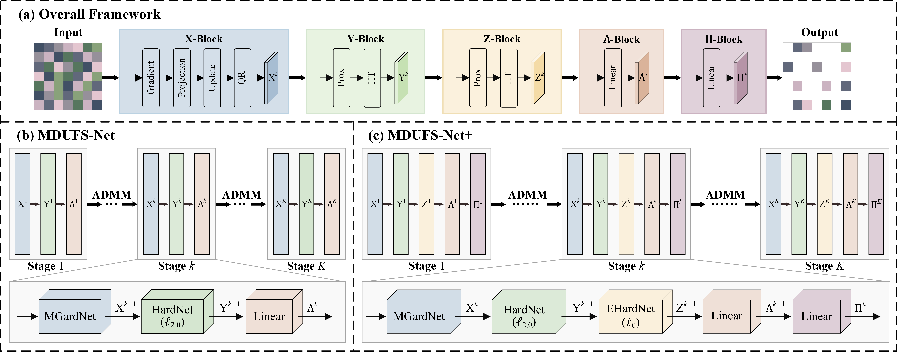

# MDUFS

The code in this toolbox implements "Learning to Select Features with Manifold Deep Unfolding PCA" by <i>J. Liu, P. Tai, X. Xiu, W. Liu</i>.

### Citation
Please give credits to this paper if this code is useful and helpful for your research.

### Acknowledgement
Please contact P. Tai for more details.
